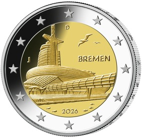
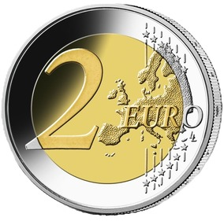

# Bekanntmachung über die Ausprägung von deutschen Euro-Gedenkmünzen im Nennwert von 2 Euro (Gedenkmünze „Bremen“) (Münz2EuroBek 2026-11-12/1)

Ausfertigungsdatum
:   2026-11-12

Fundstelle
:   BGBl. I: 2026, Nr. 341

## (XXXX)
[Direktlink](https://www.gesetze-im-internet.de/m_nz2eurobek_2026-11-12_1/BJNR1550A0026.html#BJNR1550A0026BJNE000100000)

Gemäß den §§ 2, 4 und 5 des Münzgesetzes vom 16. Dezember 1999 (BGBl.
I S. 2402) hat die Bundesregierung beschlossen, zum Thema „Bremen“
eine deutsche Euro-Gedenkmünze im Nennwert von 2 Euro prägen zu
lassen. Die Münze ist die vierte Emission im Rahmen der im Jahr 2023
begonnenen Serie „Bundesländer II“, bei der jährlich ein Land durch
die Ausgabe einer 2-Euro-Gedenkmünze mit einem prägnanten Wahrzeichen
gewürdigt werden soll.

Der Entwurf der Münze stammt von dem Künstler Bodo Broschat aus
Berlin.

Die nationale Seite zeigt das Klimahaus Bremerhaven in einer
einzigartigen Perspektive von schräg unten. Die futuristische
Architektur aus Brücken aus Glas, elliptischem Gebäude für Ausstellung
und Turm verschmilzt zu einem maritimen Gesamtbild. Möwen über dem
Hafen unterstreichen Bremen als Wissenschaftsstandort an der See. Auf
dem inneren Kern befinden sich ferner die Angabe „BREMEN“, das
Ausgabejahr „2026“, die Kennzeichnung „D“ für das Ausgabeland
Bundesrepublik Deutschland, das Münzzeichen der jeweiligen Prägestätte
(„A“, „D“, „F“, „G“ oder „J“) sowie die Initialen des Künstlers. Der
äußere Ring der nationalen Seite zeigt die zwölf Europasterne.

Die Wertseite der Münze, die Randschrift (Schriftzug „EINIGKEIT UND
RECHT UND FREIHEIT“ sowie eine stilisierte Darstellung des
Bundesadlers) und die technischen Parameter entsprechen der 2-Euro-
Umlaufmünze.

## Schlussformel
[Direktlink](https://www.gesetze-im-internet.de/m_nz2eurobek_2026-11-12_1/BJNR1550A0026.html#BJNR1550A0026BJNE000200000)

Der Bundesminister der Finanzen

## Anlage
[Direktlink](https://www.gesetze-im-internet.de/m_nz2eurobek_2026-11-12_1/BJNR1550A0026.html#BJNR1550A0026BJNE000300000)

(Fundstelle: BGBl. 2026 I Nr. 341, S. 2

*    *        
    *        

